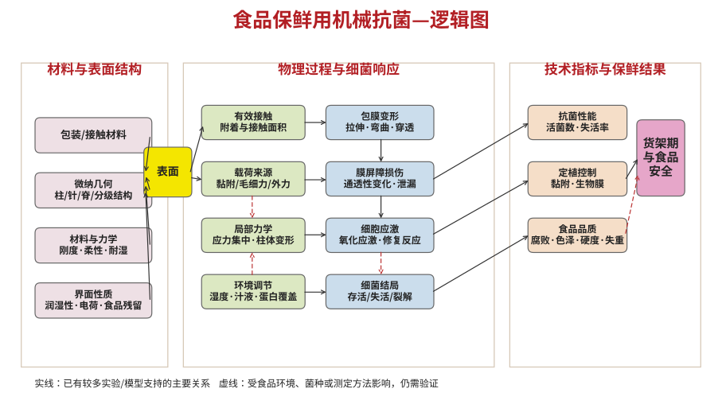

# 面向果蔬与食品保鲜的机械抗菌研究框架

本目录包含参照“有机/聚合物光伏-逻辑图”样式优化的横向逻辑图，以及食品保鲜场景的研究定位、关键科学问题、优先阅读文献、候选课题方向和一周入门路线。

## 逻辑图

## 研究主线

材料与表面结构 → 物理过程与细菌响应 → 微生物控制 → 食品品质与货架期。

## 候选课题

1. 湿态稳定的机械抗菌包装表面。
2. 食品组分覆盖对机械抗菌的影响。
3. 包装接触方式与真实果蔬保鲜效果的关联。

## 本地可下载文件

本次生成的 PDF 与 Word 版本已随对话提供下载。GitHub 连接器支持直接上传 UTF-8 文本文件，因此本目录上传逻辑图 SVG 与本说明；二进制 PDF/DOCX 保存在对话输出中。

## 主要参考文献

- Ivanova et al., Small (2012): https://doi.org/10.1002/smll.201200528
- Ivanova et al., Nature Communications (2013): https://doi.org/10.1038/ncomms3838
- Pogodin et al., Biophysical Journal (2013): https://doi.org/10.1016/j.bpj.2012.12.046
- Jenkins et al., Nature Communications (2020): https://doi.org/10.1038/s41467-020-15471-x
- Cheng et al., Annual Review of Food Science and Technology (2023): https://doi.org/10.1146/annurev-food-060721-022330
- Valiei et al., ACS Applied Materials & Interfaces (2024): https://doi.org/10.1021/acsami.3c09552
- Lee et al., Journal of Food Safety (2018): https://doi.org/10.1111/jfs.12379
- Food Packaging and Shelf Life (2024): https://doi.org/10.1016/j.fpsl.2024.101379
