# 周一汇报：完整13页文献格式修订版

本文件基于本次成功读取的《周一汇报.pptx》修改，共13页。保留原模板、页面顺序、表格、科学图像、小组信息及末尾“请各位批评指正”页。

- [下载修改后的完整PPT](Monday_XRD_references_revised.pptx)
- [查看完整PDF](Monday_XRD_references_revised.pdf)
- [查看全部13页图片](images/)

## 本次修改

1. 第7—10页的文献出处按常见毕业论文的GB/T 7714顺序编码制著录结构排版，补齐作者、完整题名、文献类型[J]、期刊全称、年卷期、文章号和DOI。图号及图片裁剪信息另行说明。
2. TT/Np-TPDA-COF两个案例出自同一论文，共用编号[1]；UiO-66、ACOF-1依次使用[2]、[3]。
3. UiO-66页明确区分Fig. 2b的PXRD曲线和Fig. 2c的TEM平均粒径数据。
4. TT-TPDA-COF页的分析改为“拟合支持候选晶胞与实验图谱相容；堆积模型仍需联合其他表征判断”，避免由Pawley拟合直接确定AA堆积。
5. 整理对应页讲稿备注，保留讲解和建议用时，补充图号、原文链接及核验范围。TT/Np两页保留原图待复核提示。

## 文献与图片核对结果

核对日期：2026-10-16。三篇论文的作者、题名、期刊、出版信息及DOI均有相符的出版社页面与Crossref记录；本次检查的这些记录中未见撤稿或更正标记。

| PPT页码及案例 | 文献 | 图片与原文的对应情况 |
| --- | --- | --- |
| 第7页，TT-TPDA-COF | [1]，题录已核实 | 公开图注对应Fig. 1a，原图独立比对尚未完成。页中Rp=3.86%、Rwp=5.28%能与PPT内图片一致，但不能据此宣称已与出版原图核对。 |
| 第8页，Np-TPDA-COF | [1]，题录已核实 | 公开图注对应Fig. 1b，原图独立比对尚未完成。页中Rp=3.47%、Rwp=4.98%能与PPT内图片一致，出版原图数值仍待核对。 |
| 第9页，UiO-66 | [2]，题录及图片已核实 | 与出版社Fig. 2b的曲线、图例、乙醇体积、峰标记及横轴对应。40、14、9、5 nm的TEM平均粒径来自Fig. 2c；超小颗粒局部结构证据还包括Fig. 2d、2f。 |
| 第10页，ACOF-1 | [3]，题录及图片已核实 | 与出版社Fig. 2d对应，实验/拟合/模拟/Bragg位置/差值曲线及反平行AA堆积插图一致。峰位及晶面归属与正文对应，Rwp=5.71%见正文。SAXS和HRTEM辅助证据见Fig. 2f—h。 |

**剩余核验限制：TT/Np论文的出版社摘要及题录可以访问，公开图注也能定位，但本次未取得可直接逐项检查的出版原图。因此没有将这两张图标为“原图已核验”。** 获取论文PDF或原始Fig. 1后，才能完成曲线、拟合参数及模型归属的独立核对。

## 参考文献条目

[1] XU Q, FU K, LIU Z, et al. Thiophene-Based Bipolar-Type Covalent Organic Frameworks with Extended π-Conjugation as Superior Cathode for Lithium-Ion Batteries[J]. Advanced Functional Materials, 2025, 35(39): 2506111. DOI: 10.1002/adfm.202506111.

[2] DAI S, SIMMS C, PATRIARCHE G, et al. Highly defective ultra-small tetravalent MOF nanocrystals[J]. Nature Communications, 2024, 15(1): 3434. DOI: 10.1038/s41467-024-47426-x.

[3] XIE Y, RONG Q, MAO F, et al. Engineering the pore environment of antiparallel stacked covalent organic frameworks for capture of iodine pollutants[J]. Nature Communications, 2024, 15(1): 2671. DOI: 10.1038/s41467-024-46942-0.

其中2506111、3434、2671为文章号。Nature Communications两张裁剪图的CC BY 4.0说明保留在页面及备注中。

## 核对来源

- [文献[1]出版社页面](https://advanced.onlinelibrary.wiley.com/doi/10.1002/adfm.202506111)、[Crossref题录](https://api.crossref.org/works/10.1002/adfm.202506111)。
- [文献[2]出版社原文](https://www.nature.com/articles/s41467-024-47426-x)、[原文Fig. 2](https://www.nature.com/articles/s41467-024-47426-x/figures/2)、[Crossref题录](https://api.crossref.org/works/10.1038/s41467-024-47426-x)。
- [文献[3]出版社原文](https://www.nature.com/articles/s41467-024-46942-0)、[原文Fig. 2](https://www.nature.com/articles/s41467-024-46942-0/figures/2)、[Crossref题录](https://api.crossref.org/works/10.1038/s41467-024-46942-0)。
- [文献[1]公开转载图注](https://www.researchgate.net/figure/PXRD-patterns-of-a-TT-TPDA-COF-and-b-Np-TPDA-COF-FT-IR-spectra-of-c-TT-TPDA-COF-and_fig1_391109100)：作为辅助图注依据，不代替出版原图核验。
- [CC BY 4.0许可](https://creativecommons.org/licenses/by/4.0/)。

## 页面预览

以下图片覆盖全部13页，可直接在GitHub中浏览。

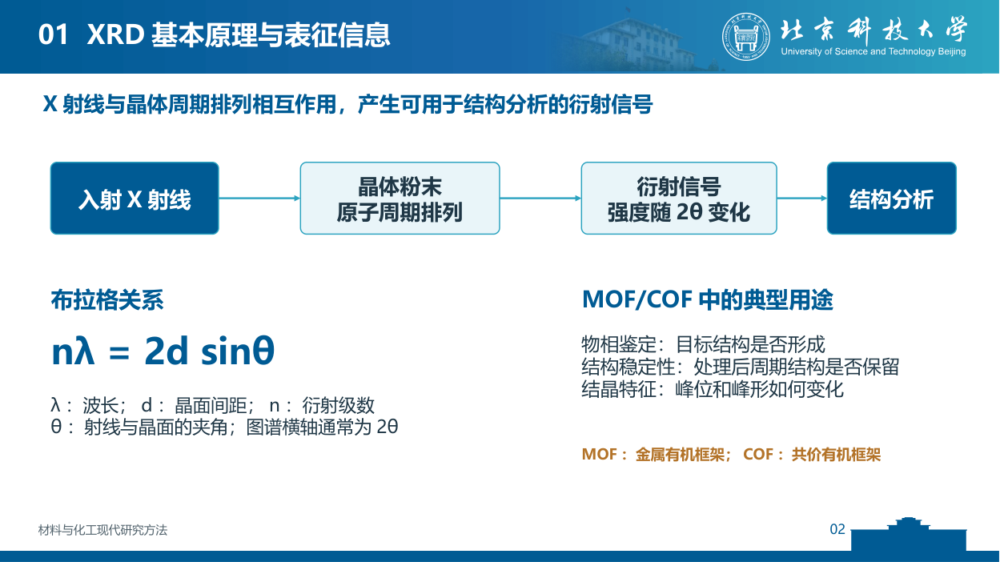
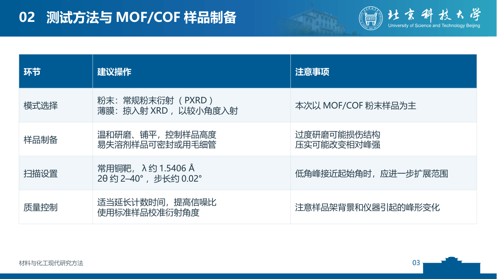
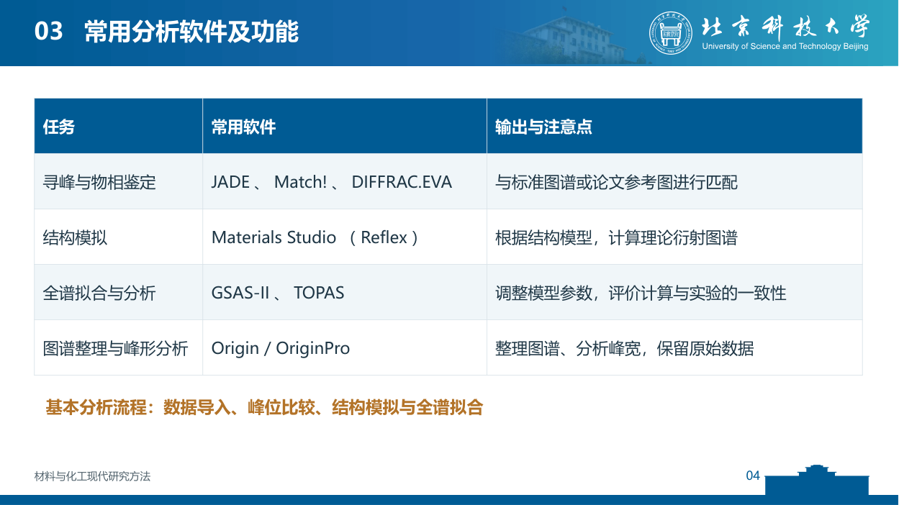
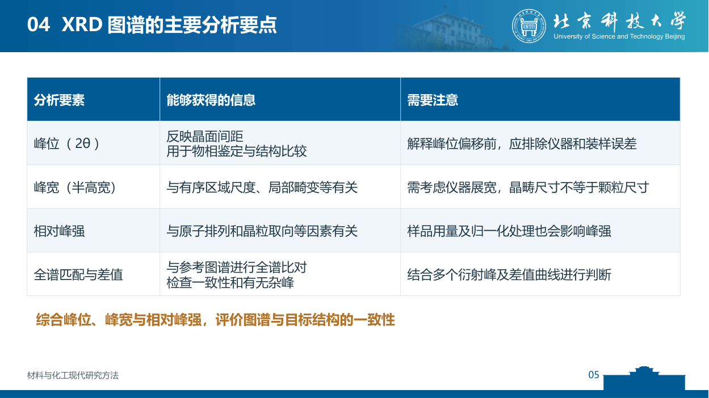
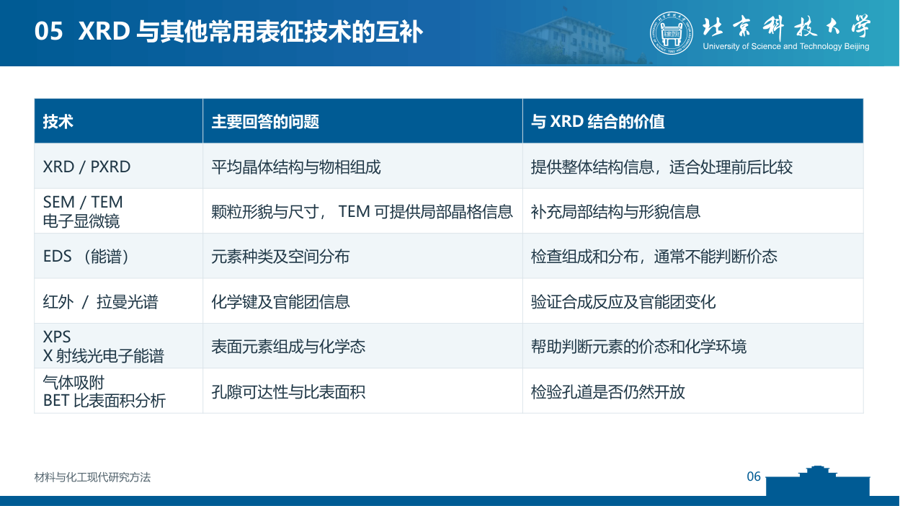
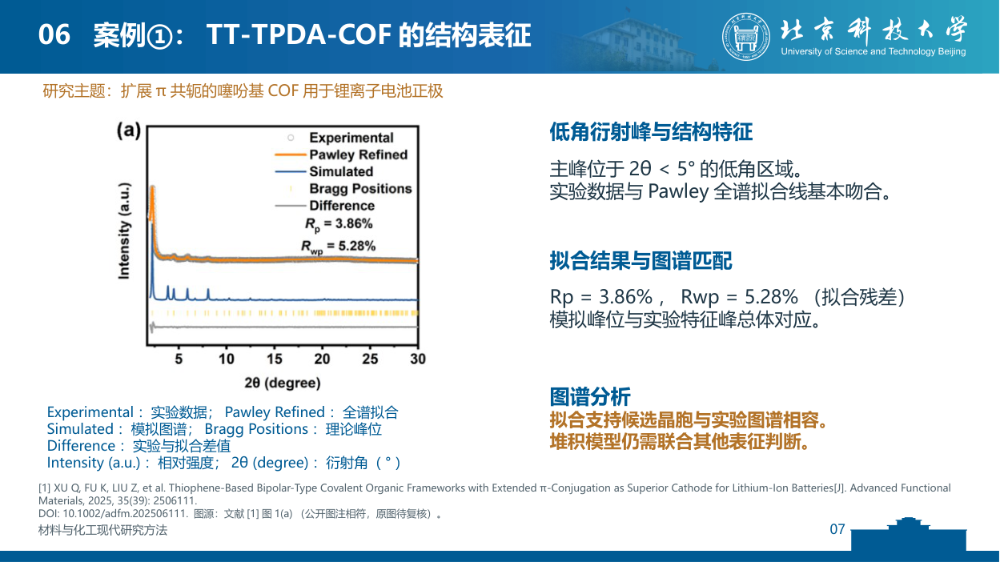
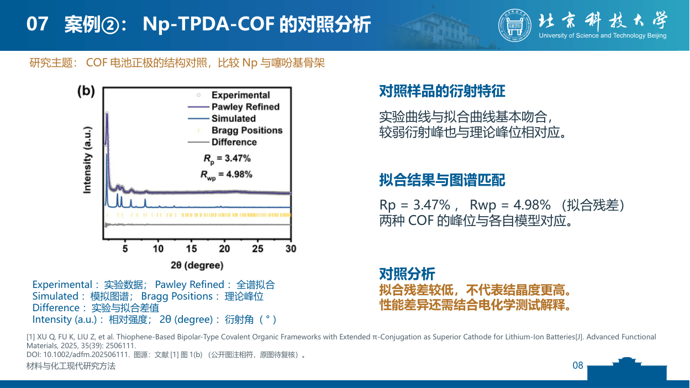
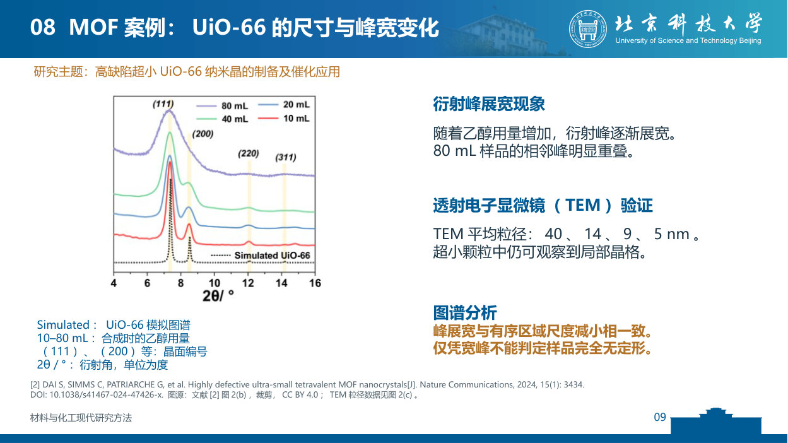
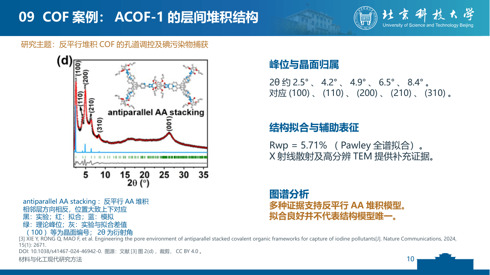
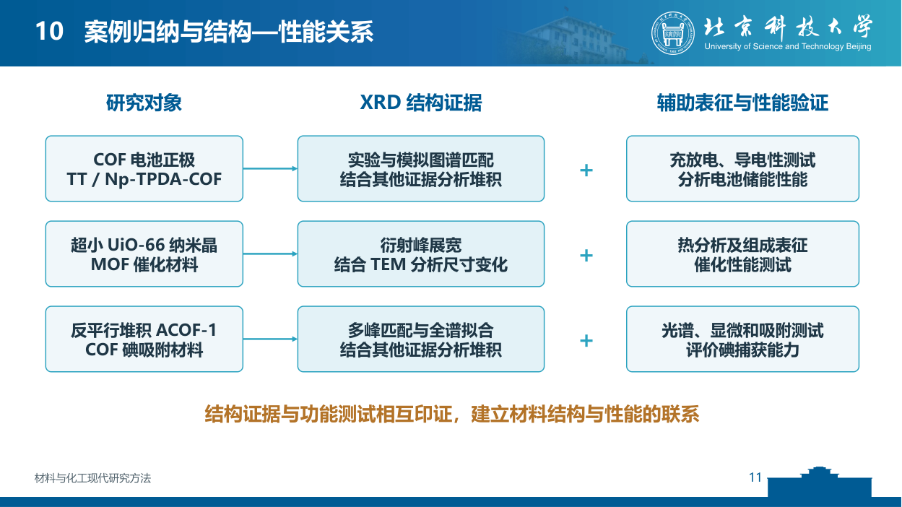
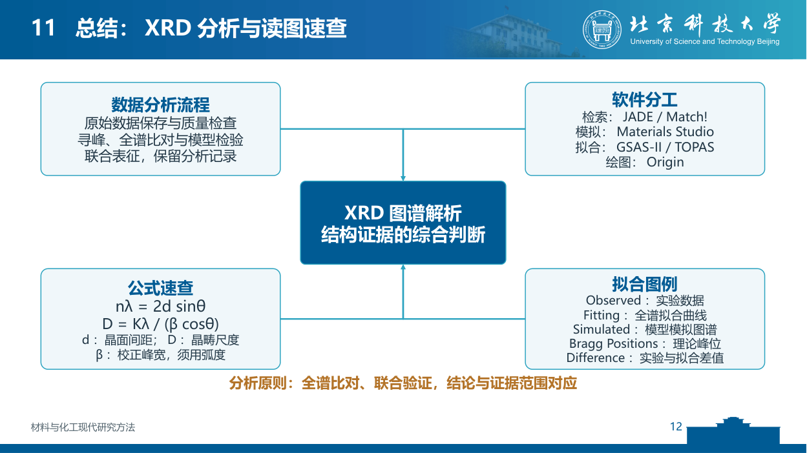

