# XRD表征与MOF / COF案例解析

《材料与化工现代研究方法》小组汇报。面向尚未开始科研的硕士一年级学生。

10页主讲按8分钟设计，另有6页备用。案例及图源见PPT备注和第15–16页。

## 下载文件

- [可编辑PPT](XRD_MOF_COF_optimized.pptx)
- [PDF版](XRD_MOF_COF_optimized.pdf)
- [全部16张PNG图片压缩包](XRD_all_16_slides_PNG.zip)
- [逐页讲稿与小组分工建议](speaker_notes_zh.md)

点击上述文件后，可使用GitHub页面上的下载按钮保存。无需下载，也可以直接浏览下方图片。

## 全部幻灯片

### 第1页：封面

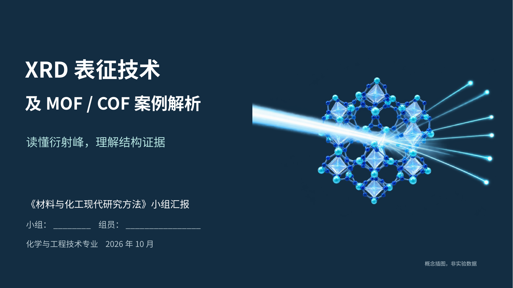

### 第2页：MOF与COF研究对象

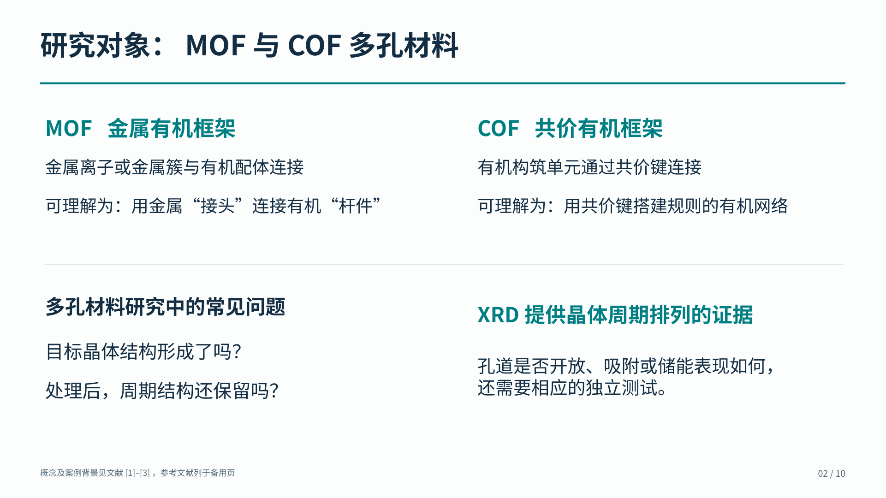

### 第3页：XRD基本原理

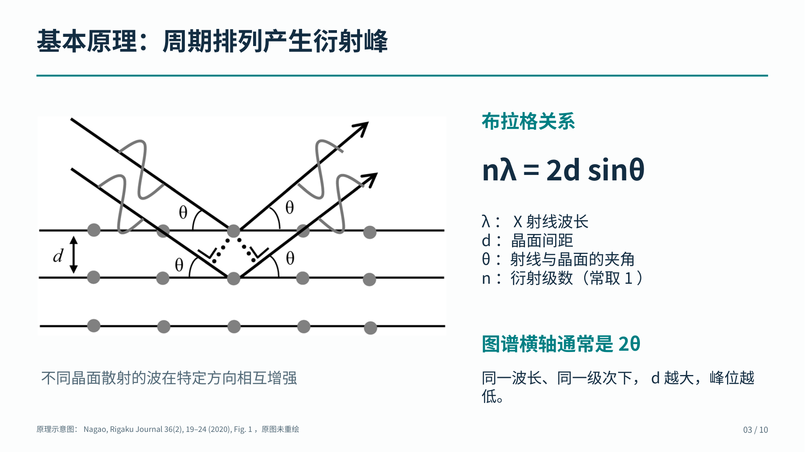

### 第4页：峰位、峰宽与相对峰强

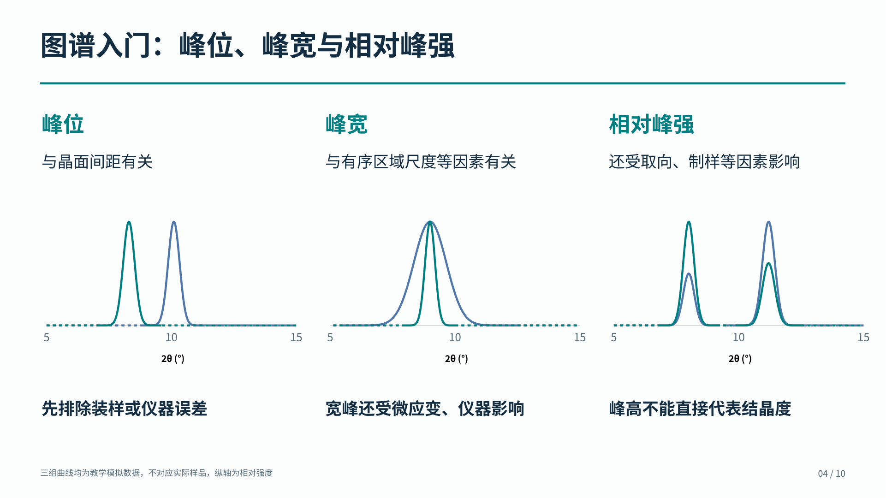

### 第5页：制样与测试条件

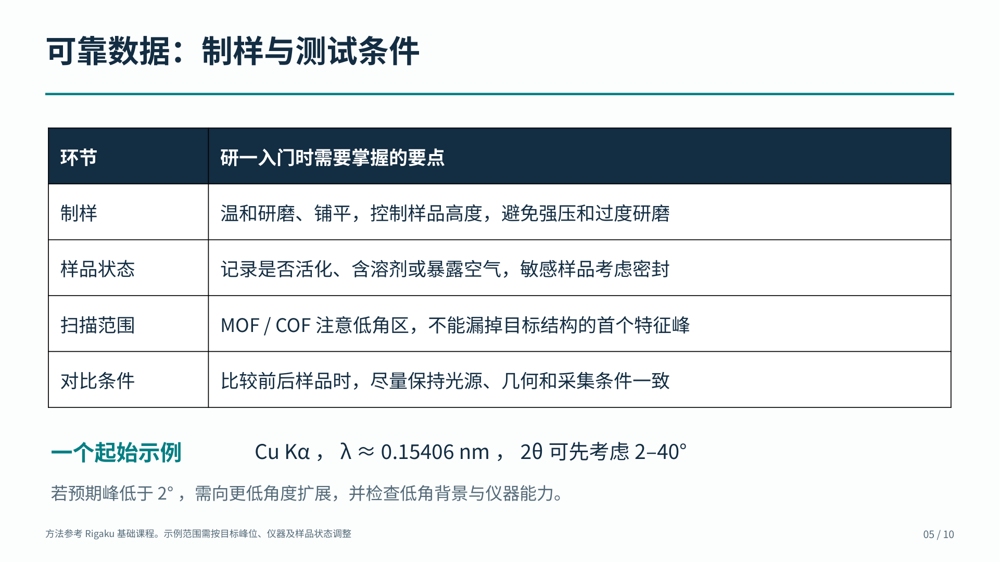

### 第6页：UiO-66案例

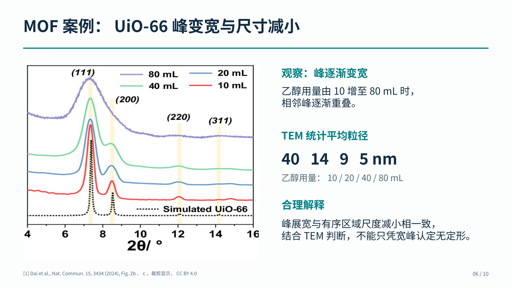

### 第7页：ACOF-1案例

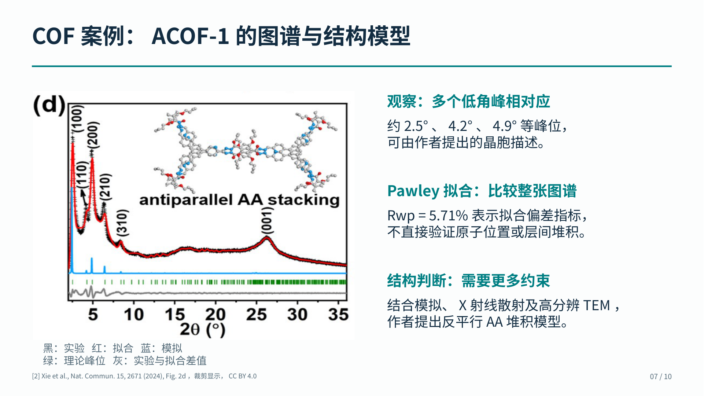

### 第8页：联合表征

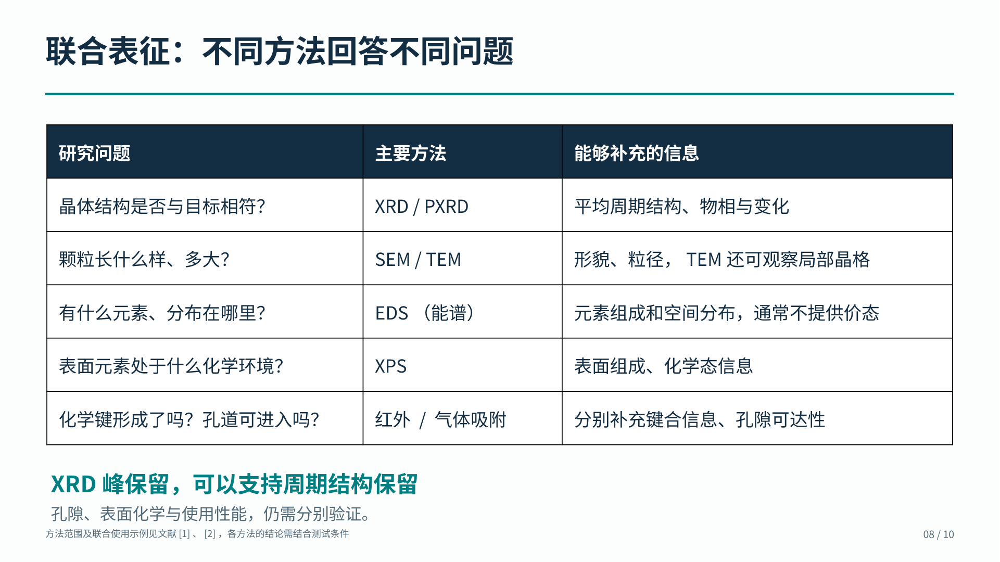

### 第9页：结构与电化学性能

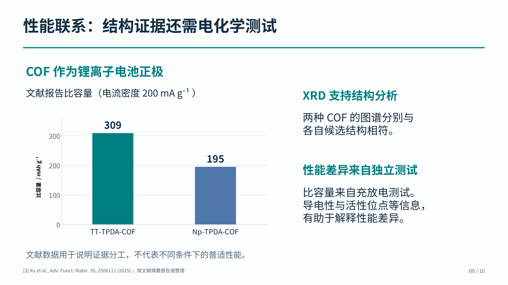

### 第10页：总结

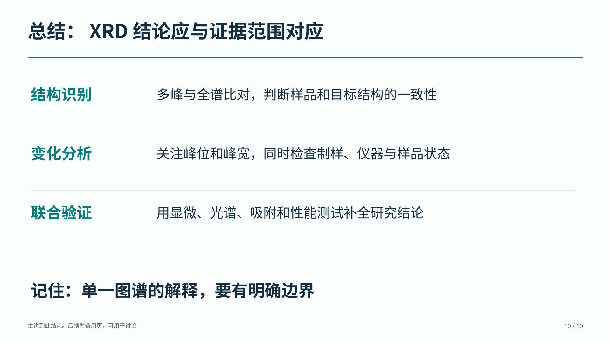

### 第11页：备用：COF原始图谱

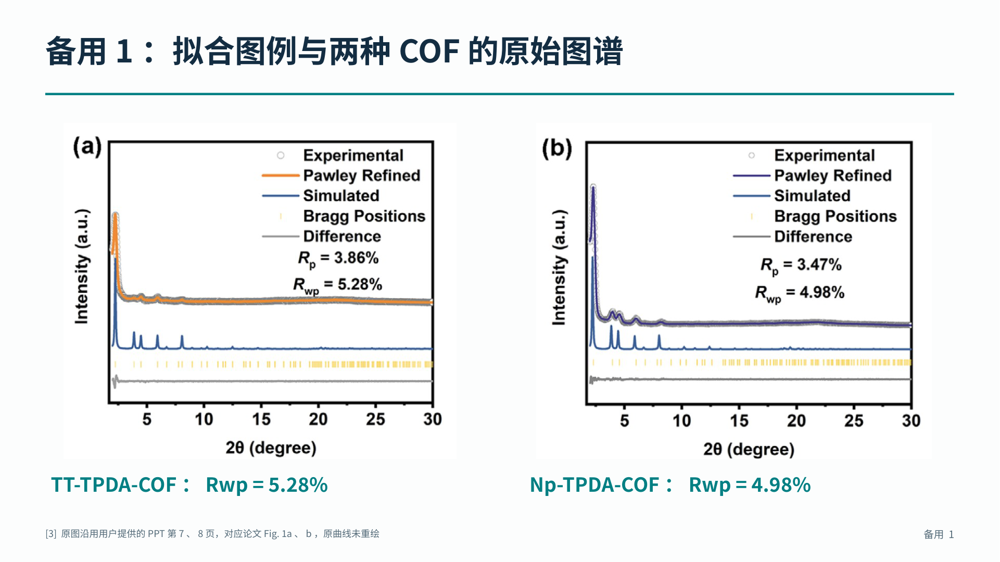

### 第12页：备用：数据分析与软件

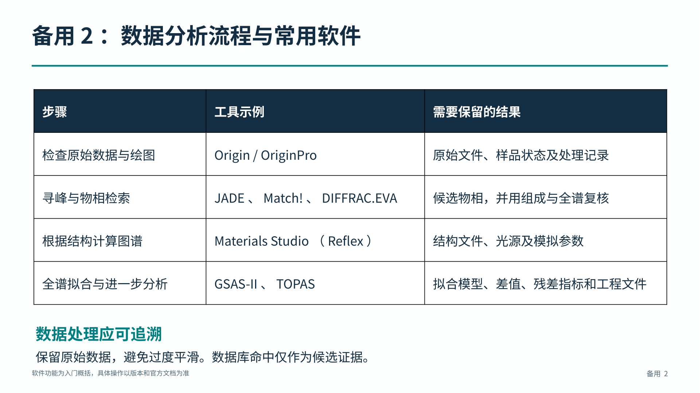

### 第13页：备用：公式计算

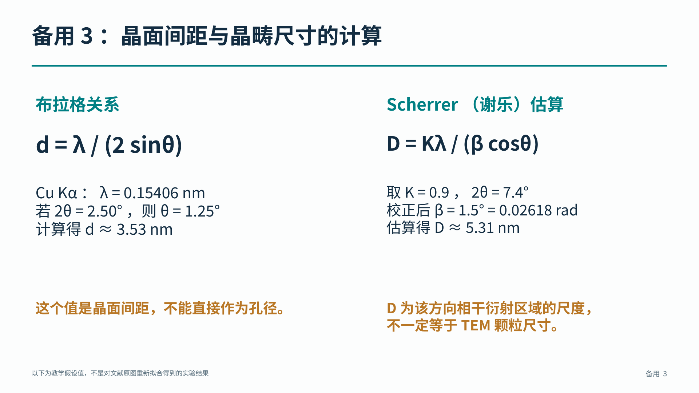

### 第14页：备用：讨论问题

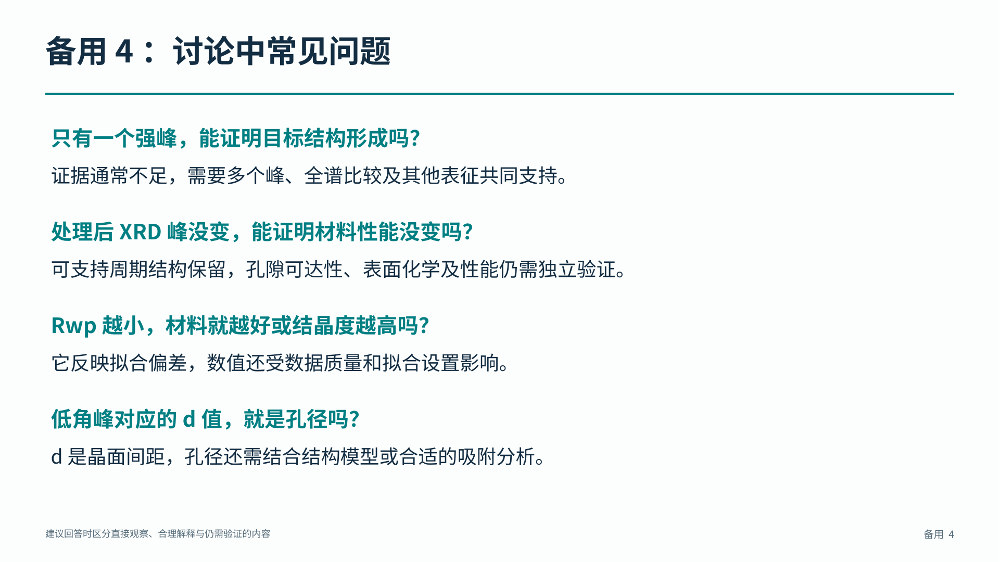

### 第15页：备用：案例文献

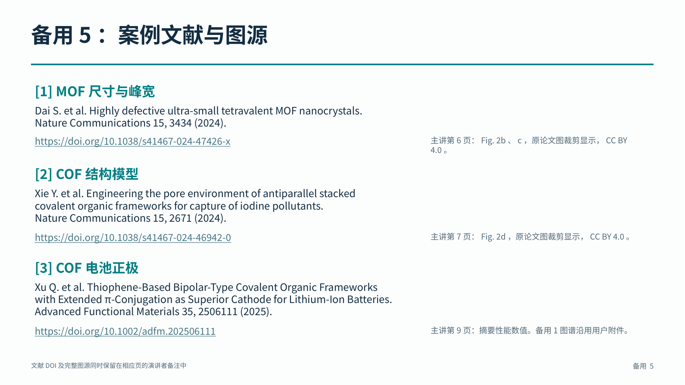

### 第16页：备用：方法资料

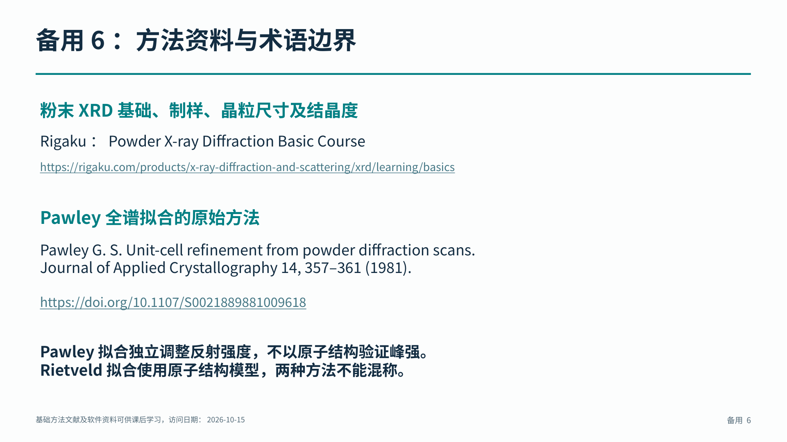
