# XRD汇报PPT：原模板精修版

本版本以此次上传的原稿为基础，保留原模板、17页页序、章节和案例安排。原有校徽、背景、图片、母版和嵌入字体均保留。

主要精修案例页的对齐、间距、图例说明，以及表格换行和内边距。少量科学表述作了澄清，图谱曲线和文献数据没有重绘或更改。

## 下载

- [下载精修后的可编辑PPT](XRD_MOF_COF_template_refined.pptx)
- [查看PDF版](XRD_MOF_COF_template_refined.pdf)

前12页为主讲部分，演讲者备注中的建议用时合计8分钟。第13—17页为附录备用。演讲者备注保留讲稿和资料来源。使用前请填写封面的汇报小组及组员信息。

## 全部17页预览

### 第1页：封面

### 第2页：XRD基本原理与表征信息

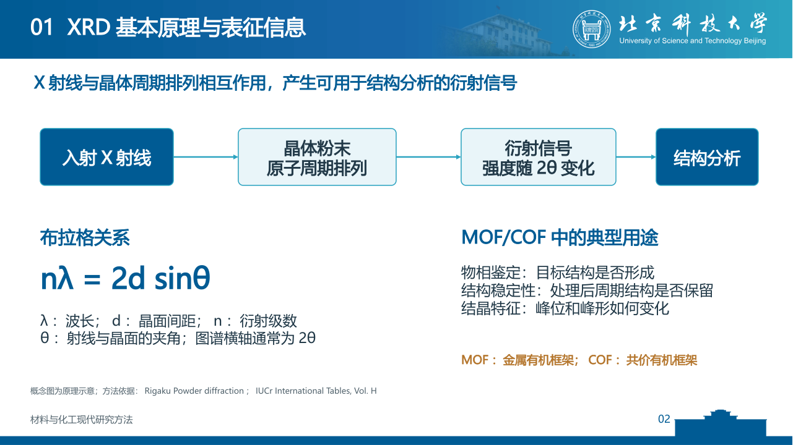

### 第3页：测试方法与MOF/COF样品制备

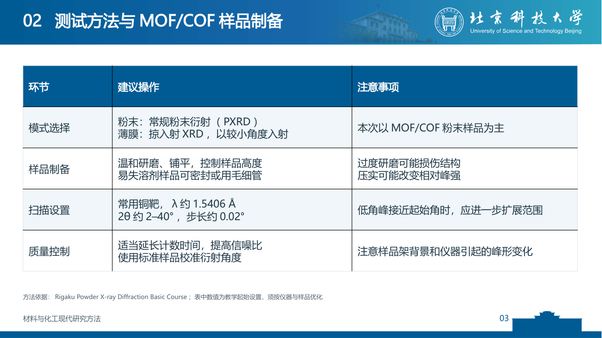

### 第4页：常用分析软件及功能

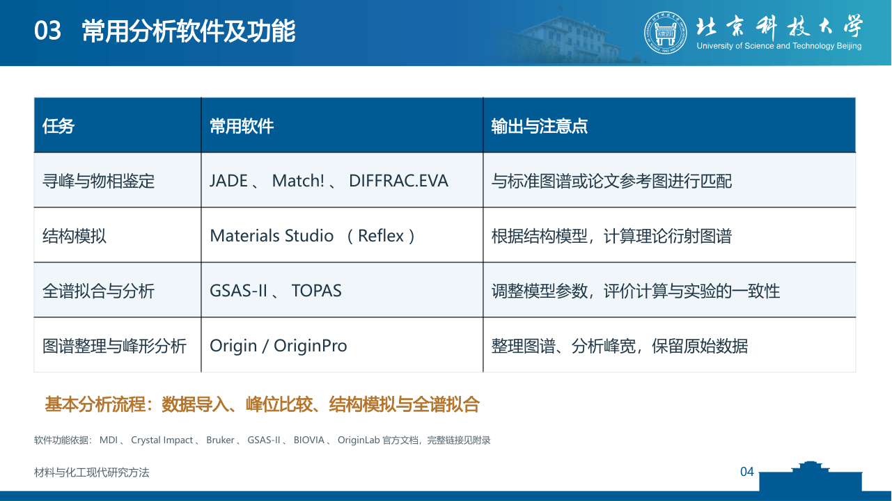

### 第5页：XRD图谱的主要分析要点

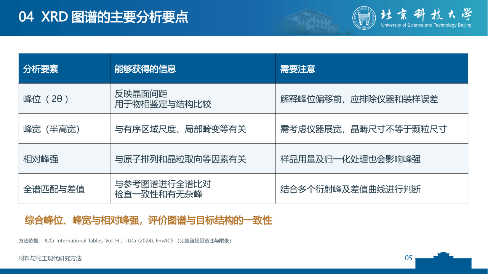

### 第6页：XRD与其他常用表征技术的互补

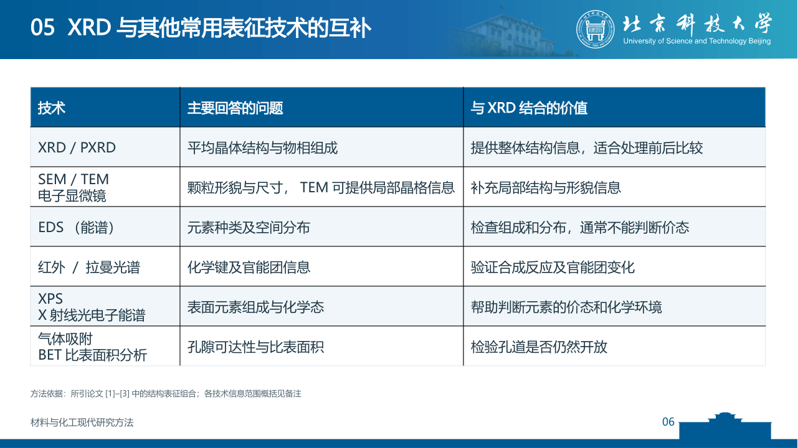

### 第7页：TT-TPDA-COF结构表征

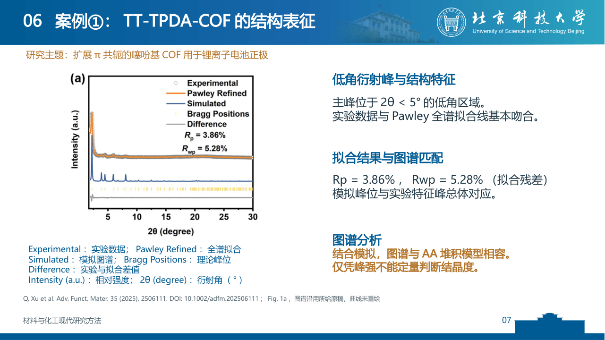

### 第8页：Np-TPDA-COF对照分析

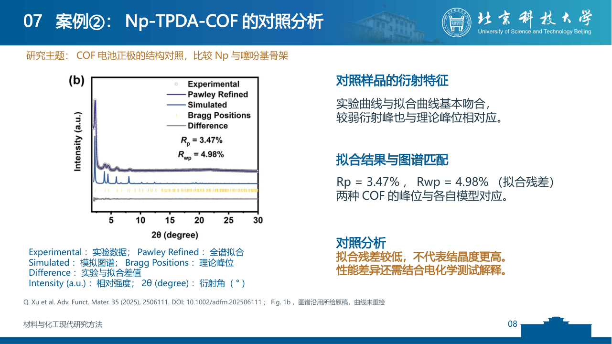

### 第9页：UiO-66尺寸与峰宽变化

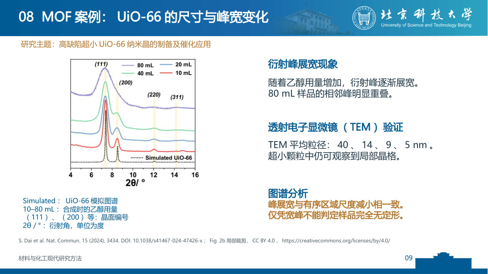

### 第10页：ACOF-1层间堆积结构

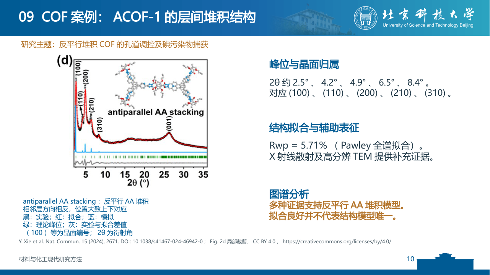

### 第11页：案例归纳与结构—性能关系

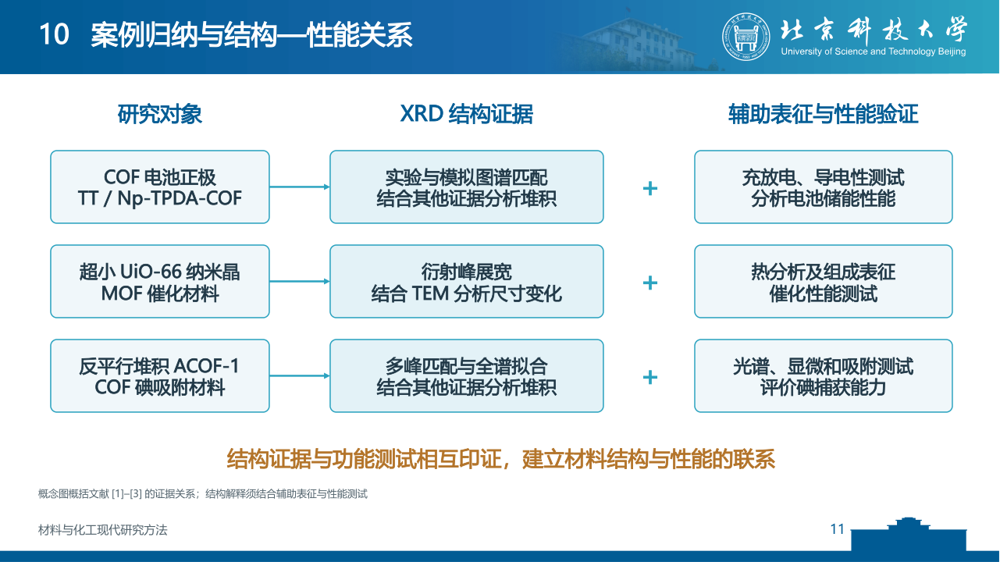

### 第12页：总结

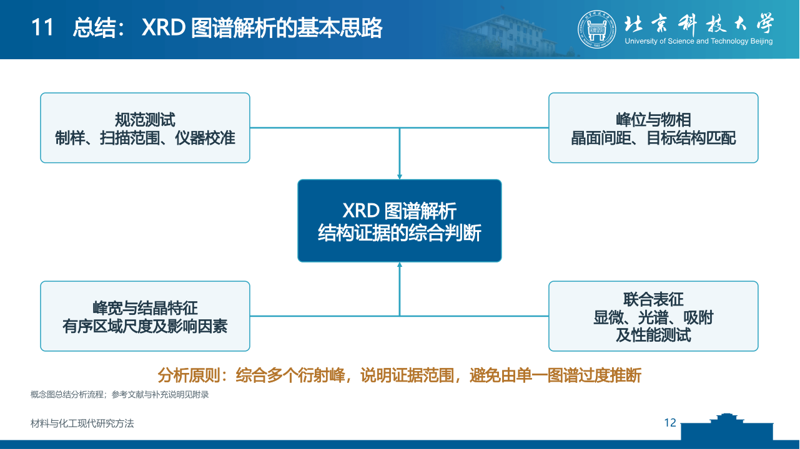

### 第13页：附录A：XRD数据分析基本流程

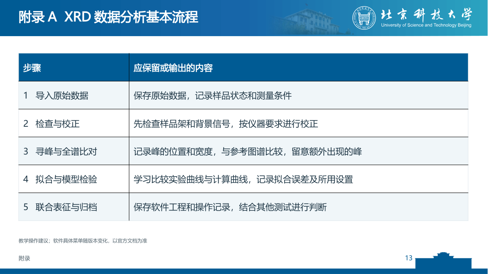

### 第14页：附录B：晶面间距与有序区域尺度估算

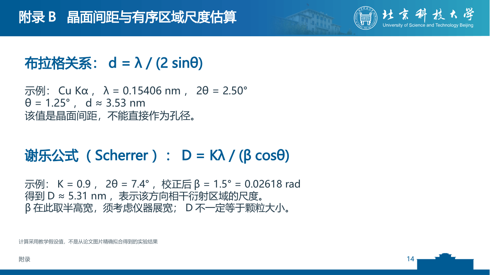

### 第15页：附录C：图谱英文术语

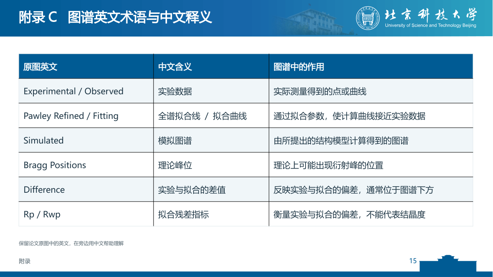

### 第16页：附录D：案例文献与原图

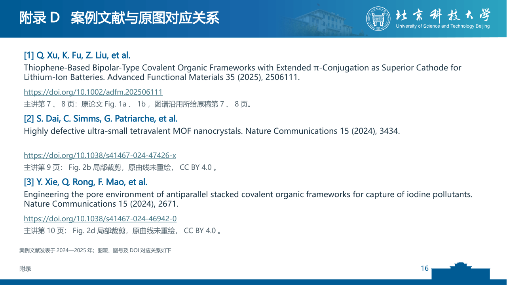

### 第17页：附录E：方法与软件资料

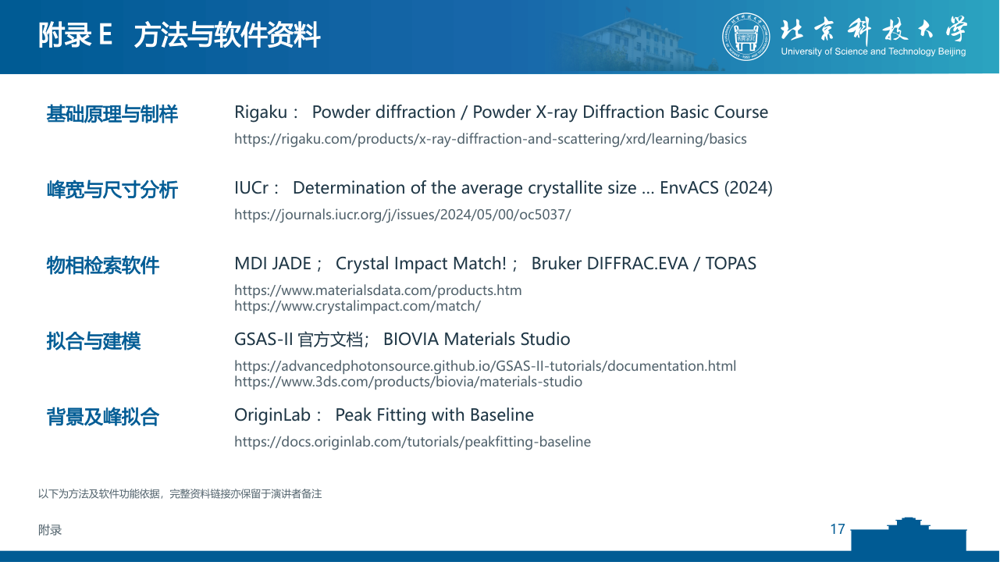
